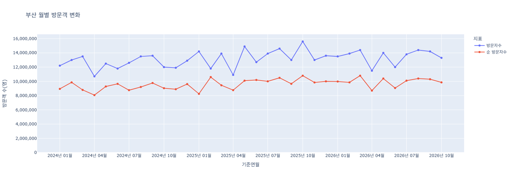
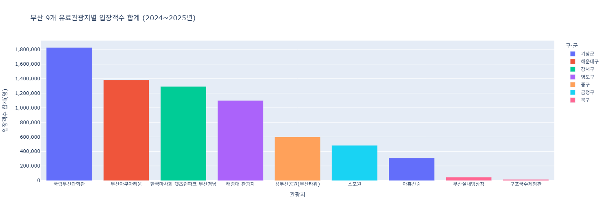
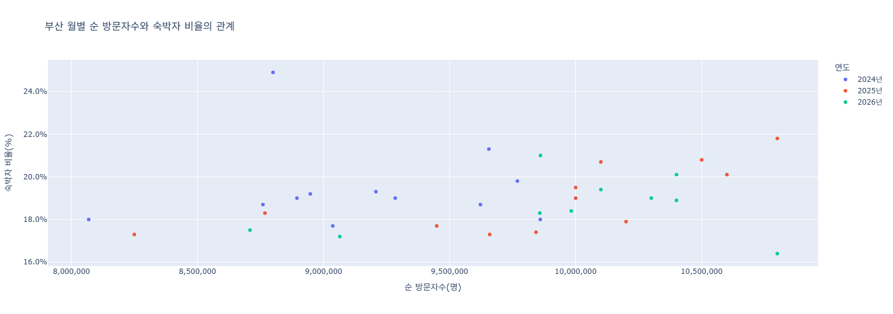
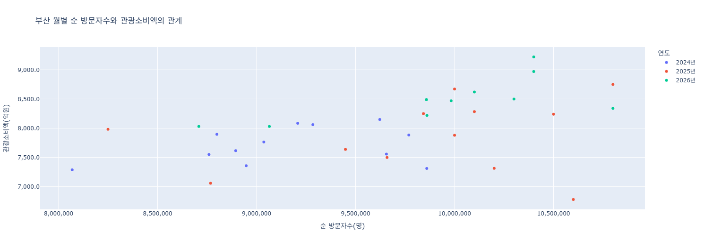

# 부산 관광 수요와 숙박·소비 특성 분석

- 작성일: 2026년 11월 26일

## 분석 개요

### 분석 배경과 목적

관광 수요를 살펴볼 때 방문 규모와 함께 숙박 비중·소비 규모가 어떻게 나타나는지 확인하면 서로 다른 관광 특성을 구분할 수 있다. 
본 분석은 부산의 월별 방문 지표와 주요 관광지의 입장객 집중도를 살펴보고, 방문 규모와 숙박·소비의 관계를 탐색하는 데 목적이 있다.

분석 결과를 바탕으로 관광 활성화 방안을 검토하고 향후 추적할 KPI 후보를 제안한다. 실제 관광사업의 성과를 평가하거나 개인별 숙박·소비 전환을 추적한 분석은 아니다.

### 분석 질문

1. 부산의 방문 규모는 월별로 어떻게 변하며, 여러 해에 반복되는 계절적 특징이 있는가?
2. 수집된 9개 관광지 중 입장객은 어느 시설에 집중되는가?
3. 방문객이 많은 달에 숙박자 비율도 높게 나타나는가?
4. 방문객이 많은 달에 관광소비액도 많으며, 방문 규모를 고려한 소비 지표가 높은 달은 언제인가?

### 분석 범위

| 항목 | 범위 |
| --- | --- |
| 대상 지역 | 부산광역시 |
| 전체 자료 기간 | 2024년 1월~2026년 10월, 34개월 |
| 월별 평균·계절별 비교 | 2024~2025년의 완결된 두 개 연도 |
| 관광지별 비교 | 원본에 포함된 9곳의 2024~2025년 자료 |
| 숙박·소비 관계 비교 | 부산 전체의 34개월 월별 지표 |
| 분석 환경 | Google Drive·Colab, Python·pandas, Plotly |
| 자료 수집 방식 | 한국관광 데이터랩에서 내려받은 CSV |

초기 계획의 구·군별 숙박·소비, 동부산·중부산·서부산 간 성과 비교는 현재 자료로 수행하지 않았다. 본문에서 시설별 입장객 비교와 부산 전체 월별 관계 분석을 구분한다.

## 사용 데이터와 지표 정의

| 파일 | 원본 구조 | 주요 항목 |
| --- | --- | --- |
| 월별통합표(df1) | 34행 × 4열 | 기준연월, 방문자수, 순 방문자수, 숙박자 비율 |
| 관광소비상세표(df2) | 272행 × 3열 | 기준연월, 7개 업종과 전체 합계, 소비액(천원) |
| 유료관광지점상세표(df3) | 306행 × 6열 | 기준연월, 관광지명, 지역, 입장객수, 원본 순위 |

방문자수는 일별 방문 인원을 누적한 연인원이다. 같은 사람이 여러 날짜에 방문하면 날짜별로 반영된다. 
순 방문자수는 숙박·체류 탭의 월 단위 방문 인원으로, 동일인의 연속 체류에 따른 중복을 줄인 지표이다. 
예를 들어 4명이 3일 연속 방문하면 방문자수는 12명, 연속 체류를 중복 제거한 방문 인원은 4명이다. 모든 재방문까지 무조건 제거하거나 월별 합계를 연간 고유 인원으로 해석하지 않는다.

숙박자 비율은 제공기관의 이동통신 기반 숙박 방문자 비율이며 실제 예약 전환율이나 체류시간이 아니다. 
소비액은 신용카드 기반 자료로, 제공기관이 추세 분석용 활용을 권장하는 금액이다. 방문자수·소비액을 개인 수준에서 연결한 자료는 아니다.

관광지 9곳은 병합 전 다운로드 CSV 두 개에 공통으로 포함된 지점이다. 분석자가 부산 전체에서 대표성 기준으로 추출한 표본이나 부산 전체 유료관광지 상위 9곳은 아니다.

- [방문 지표 정의 — 한국관광 데이터랩](https://datalab.visitkorea.or.kr/datalab/portal/loc/getAreaDataForm.do?SGG_CD=26)
- [통계 대상과 보고 체계 — 관광지식정보시스템](https://know.tour.go.kr/stat/visitStatDis/introduce.do)

## 데이터 준비

Google Drive의 tourism 폴더에 저장한 CSV를 Colab에서 불러왔다. 방문자수·순 방문자수·소비액·입장객수의 쉼표를 제거하고 숫자형으로 변환했다. 입장객수의 하이픈은 결측으로 처리하고 0으로 채우지 않았다.

세 파일의 기간은 모두 202401~202610이었다. 관광소비상세표는 병합·정렬 오류가 있던 파일을 원본 두 개로 재생성하여 34개월 × 8개 항목 = 272행으로 정리했다.

관광지 입장객수에는 2026년에만 57건의 결측이 있었다. 시설 간 비교 기간은 2024~2025년으로 제한했다. 이 기간에 NaN이 없다는 사실이 원본의 0이 모두 실제 입장객 0명이라는 뜻은 아니며, 미입력 0 가능성은 별도의 한계로 남겼다.

소비 분석에서는 업종별 상세와 전체 합계를 중복 합산하지 않도록 전체 항목만 선택했다. 기준연월로 월별통합표와 일대일 연결한 결과 34행이며 소비액 결측은 0건이었다.

2026년 11~12월은 미관측 기간이므로 값을 추가하거나 0으로 채우지 않았다. 전체 코드 실행과 해석 재검토를 완료했다.

## 주요 분석 결과

### 월별 방문객 변화와 계절성

2024~2025년의 같은 월끼리 평균을 비교한 결과는 다음과 같다.

| 지표 | 월별 평균 최고 | 월별 평균 최저 |
| --- | --- | --- |
| 방문자수 | 8월, 14,050,000명 | 4월, 10,800,000명 |
| 순 방문자수 | 2월, 10,229,832명 | 4월, 약 8,418,022명 |

연도별로 보면 방문자수는 세 해 모두 관측 범위에서 4월이 가장 낮았다. 순 방문자수는 2024·2026년에 4월, 2025년에 1월이 가장 낮아 월별 평균과 개별 연도 결과를 구분해야 한다. 2026년은 1~10월 내 비교이다.

2024~2025년 계절별 월평균에서 방문자수와 순 방문자수 모두 최고 계절이 연도에 따라 달랐다. 순 방문자수는 두 해 모두 봄에 가장 낮았지만 두 개 연도만으로 고정된 성수기나 일반적인 계절성을 확정하기는 어려웠다. 
코드의 겨울은 같은 연도의 1·2·12월 평균으로 연속된 한 겨울이 아니다.

**인사이트:** 관광 수요의 최고 시기는 어떤 방문 지표를 보느냐에 따라 다르다. 두 해에서 관찰된 낮은 방문 시기를 참고할 수 있으나, 고정된 성수기·비수기 정책으로 일반화하려면 이전 연도 자료와 당시의 상황을 추가 확인할 필요가 있다.

### 관광지별 입장객 집중도

2024~2025년 수집된 9개 관광지의 입장객수 합계는 7,055,336명이었다. 국립부산과학관 1,827,141명, 부산아쿠아리움 1,382,424명, 한국마사회 렛츠런파크 부산경남 1,292,378명, 태종대 관광지 1,100,195명 순으로 상위에 나타났다.

상위 4곳의 합계는 5,602,138명으로 9곳 전체의 약 79.4%를 차지했다. 이 값은 고유 관광객 비중이 아니라 자료에 기록된 시설 입장 건수의 비중이다.

공식 안내 주소상 상위 4곳은 각각 기장군·해운대구·강서구·영도구에 위치한다. 네 곳이 같은 관광단지에 인접해 있다고 보기 어렵지만, 주소만으로 동일인의 중복 방문이나 근접성의 효과를 확인할 수는 없다.

**인사이트:** 확보한 시설 자료의 입장 건수는 일부 지점에 집중되어 있다. 관광지 간 연계 가능성을 검토하는 출발점으로 활용할 수 있으나, 부산 전체의 지역별 관광객 집중이나 개별 시설의 경쟁력 차이를 입증한 결과는 아니다. 미입력 0과 시설별 집계 범위 확인도 필요하다.

### 숙박·체류 특성

34개월 월별 지표에서 숙박자 비율과의 상관계수는 순 방문자수 0.175, 방문자수 0.298이었다. 순 방문자수와 숙박자 비율의 산점도에서도 일관된 상승 또는 하락 방향은 뚜렷하지 않았다.

**인사이트:** 방문 규모가 큰 달에 숙박자 비율도 뚜렷하게 높다고 판단하기 어렵다. 방문 수요의 확대와 숙박 비중의 변화를 함께 추적할 필요가 있다. 다만 숙박자 비율이 낮다고 숙박자 수도 적다는 뜻은 아니며, 숙박 시설이나 콘텐츠 부족이 원인이라고 판단할 근거는 없다.

### 관광소비 및 방문 규모 대비 소비액

순 방문자수와 관광소비액의 상관계수는 0.457로, 방문 규모가 큰 달에 소비액도 높은 경향이 나타났다. 관계의 원인이나 사업 효과를 검증한 결과는 아니다.

자료 내 관광소비액이 가장 높은 달은 2026년 5월(9,220억원), 가장 낮은 달은 2025년 2월(약 6,780.5억원)이었다. 원본의 소비액 단위가 천원임을 확인하고 억원으로 환산했다.

소비액(원)을 순 방문자수로 나눈 참고 지표는 2025년 1월 약 96,748원으로 가장 높았다. 총소비액이 최고였던 2026년 5월은 약 88,653.8원으로 이 지표에서 5위였다.

**인사이트:** 총소비액이 높은 달과 방문 규모 대비 소비 지표가 높은 달은 다를 수 있어 함께 관찰할 필요가 있다. 이 비율은 방문자수가 작아져도 높아질 수 있으며 실제 한 사람이 평균적으로 지출한 금액이나 소비 활성화 성과로 해석하지 않는다.

## 종합 결론

부산의 관광 수요를 하나의 방문 지표만으로 설명하기는 어렵다. 연인원 방문자수와 순 방문자수는 월별 최고 시기가 달랐으며, 관찰한 두 해에서는 고정된 계절적 성수기를 확정하기 어려웠다.

수집된 9개 관광지에서는 상위 4곳에 입장 건수의 약 79.4%가 집중되어 있었다. 그러나 이 자료만으로 부산 전체 관광객의 지역별 분포나 동일인의 관광지 간 중복 방문을 설명할 수는 없다.

방문 규모와 숙박자 비율의 관계는 약했고, 관광소비액과는 어느 정도 양의 선형 관계가 나타났다. 따라서 방문 규모의 변화와 함께 숙박 비중·소비 추세를 각각 확인하는 관점이 필요하다. 이 결론은 월별 집계자료의 기초 탐색에 한정된다.

## 개선안 및 추가 검증 제안

아래 내용은 분석에서 관찰한 결과를 활용할 방향이며 실제 효과가 검증된 대책이 아니다.

| 관찰한 결과 | 검토할 제안 | 시행·판단 전에 추가 확인할 내용 |
| --- | --- | --- |
| 두 해에 공통된 고정 성수기를 확정하기 어려움 | 같은 월끼리 수요 변화를 비교하며 대응 시기 검토 | 이전 연도, 휴일·행사·집계 기준 변경 등 |
| 방문 규모와 숙박자 비율의 관계가 약함 | 숙박 유도를 목표로 한다면 야간 활동·숙박 연계 콘텐츠 등 후보를 검토 | 방문 목적, 숙박 유형·공급, 여행 일정과 대상 고객 |
| 일부 관광지에 입장 건수가 집중 | 시설·주변 관광자원을 연결할 후보 검토 | 실제 이동거리·시간, 이용객 특성, 중복 방문·이동 정보 |
| 총소비액 최고 월과 방문 규모 대비 지표 최고 월이 다름 | 두 지표와 방문 규모를 함께 관찰하고 변화 원인을 점검 | 업종 구성, 체류 특성, 물가와 휴일, 자료 대상 범위 |

상위 관광지의 입장객을 줄이거나 특정 지역의 투자를 확대해야 한다는 결론은 도출하지 않았다. 제안을 사업으로 구체화할 때는 대상·목표와 추가 근거를 먼저 정해야 한다.

## 분석을 통해 제안할 수 있는 KPI

| KPI 후보 | 제안 근거 | 측정 방법 |
| --- | --- | --- |
| 월별 순 방문자수 전년 동월 증감률 | 같은 시기의 방문 수요 변화 추적 | (당월 순 방문자수 ÷ 전년 같은 달 순 방문자수 - 1) × 100 |
| 월별 숙박자 비율 변화 | 방문 규모와 숙박 비중을 함께 관찰할 필요 | 당월 숙박자 비율 - 전년 같은 달 숙박자 비율(%p) |
| 월별 관광소비액 전년 동월 증감률 | 방문 수요와 소비 규모를 함께 관찰할 필요 | (당월 관광소비액 ÷ 전년 같은 달 관광소비액 - 1) × 100 |

월별로 추적하는 후보이며 현재 자료에서 전년 동월 비교는 2025년 전체와 2026년 1~10월에 가능하다. 2024년의 전년 동월 증감률은 2023년 자료가 없어 계산할 수 없다.

사업 목표·기간·기준선에 맞는 목표치는 설정하지 않았다. 위 산식의 전년 동월 증감률이나 숙박 비율의 %p 변화도 이번 노트북에서 별도로 계산·평가한 결과는 아니다.

순 방문자수 대비 소비액과 상위 4곳 입장객 비중은 보조 참고 지표로 둔다. 실제 사업의 효과나 목표 달성을 검증한 것으로 설명하지 않는다.

## 분석의 한계와 확인 과제

- 계절 비교에 사용한 완결연도는 2024·2025년 두 해이며, 2026년은 1~10월 자료만 있다.
- 9개 관광지는 다운로드 자료에 포함된 지점이다. 부산 전체 관광지를 대표하는 표본이나 모든 관광지 목록은 아니다.
- 시설 입장객수는 반복·중복 입장을 포함할 수 있고 지역 관광객 총량과 다르다. 관광지 간 중복률이나 동선을 확인할 자료는 없다.
- 제공기관 안내상 미입력 값도 0으로 표시될 수 있다. NaN이 없다는 사실만으로 자료가 모두 입력되었다고 판단하지 않는다.
- 부산시 안내는 태종대유원지 입장이 무료라고 설명한다. 원본의 태종대 관광지 항목이 집계하는 구역·시설의 범위는 별도 확인이 필요하다.
- 이동통신 방문 지표와 신용카드 소비액은 동일한 개인의 인원·지출을 연결한 자료가 아니다. 방문 규모 대비 소비 비율은 실제 개인별 평균 지출액이 아니다.
- 숙박자 비율은 실제 예약 전환율이나 체류시간이 아니다.
- 상관계수는 월별 집계자료의 피어슨 선형 관계이며 인과관계를 의미하지 않는다. 연도·월·휴일·물가 등은 별도 통제하지 않았고 통계적 유의성 검정도 수행하지 않았다.
- 개선안과 KPI는 향후 검토·추적 제안이다. 실제 사업을 시행하거나 개선 효과를 확인하지 않았다.

자료의 0과 시설별 집계 범위가 미확인인 관광지 결과는 자료상 집중도로 한정한다. 이 불확실성을 해소하기 전에는 정책·투자 판단이나 시설 간 우열의 근거로 확대하지 않는다.

## 출처와 재현 자료

- [분석 코드와 주요 그래프 — Tourism_EDA.ipynb](https://colab.research.google.com/drive/1kiajNYLlHva_JloLLA72QPehptZJqmT5)
- [한국관광 데이터랩 — 지역별 관광현황, 방문·숙박 지표](https://datalab.visitkorea.or.kr/datalab/portal/loc/getAreaDataForm.do?SGG_CD=26)
- [한국관광 데이터랩 — 방문·소비 지표 이용 안내](https://datalab.visitkorea.or.kr/datalab/portal/loc/getAreaVisitDataForm.do)
- [한국관광 데이터랩 — 주요 유료관광지점 자료 주의사항](https://datalab.visitkorea.or.kr/datalab/portal/loc/getAreaDataForm.do?SGG_CD=52)
- [관광지식정보시스템 — 주요관광지점 통계소개](https://know.tour.go.kr/stat/visitStatDis/introduce.do)
- [관광지식정보시스템 — 입장객통계 자료 이용 안내](https://know.tour.go.kr/stat/visitStatDis/table.do)
- [국립부산과학관 — 위치](https://www.sciport.or.kr/kor/CMS/Contents/Contents.do?mCode=MN212)
- [부산아쿠아리움 — 위치](https://www.visitsealife.com/busan/plan-your-visit/before-you-visit/directions-parking/)
- [한국마사회 렛츠런파크 부산경남 — 위치](https://www.kra.co.kr/voc/park/transInfo3.do?menuId=skr0385_skr03851_skr038513)
- [부산광역시 — 태종대유원지 위치·입장 안내](https://www.busan.go.kr/park/greencitybusan04)

원자료는 내려받아 보관한 CSV를 활용했다. 보고서에 사용할 핵심 그래프는 Colab의 연도별 월별 방문 비교, 관광지별 막대그래프, 숙박자 비율 산점도, 소비액 산점도이다.
